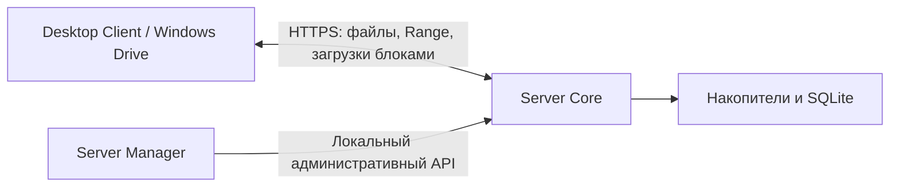

# Cloud Storage

[](LICENSE)
[](https://github.com/prostoodin1/Cloud-storage/releases/tag/v0.10.8b4)

Собственное облачное хранилище: сервер на вашем компьютере, клиент для файлов
и передач, управление пользователями и подключение пространства как диска Windows.
Данные передаются по HTTPS; сервер хранит файлы на выбранных вами накопителях.

**Текущий опубликованный Windows-релиз: [0.10.8b4, beta](https://github.com/prostoodin1/Cloud-storage/releases/tag/v0.10.8b4).**
Проект развивается; готовность исходников, собранного пакета и реального устройства
проверяется отдельно. Стабильная скорость 60–200 МБ/с через интернет пока не подтверждена.

## Скачать

| Windows x64 | Назначение | Загрузка |
|---|---|---|
| Клиент | Полный установщик; включает компонент WinFsp для виртуального диска | [Client Setup b4](https://github.com/prostoodin1/Cloud-storage/releases/download/v0.10.8b4/CloudStorage-Client-Setup-0.10.8b4-windows-x64.exe) |
| Сервер | Полный установщик менеджеров, ядра и службы | [Server Setup b4](https://github.com/prostoodin1/Cloud-storage/releases/download/v0.10.8b4/CloudStorage-Server-Setup-0.10.8b4-windows-x64.exe) |
| Переносной клиент | ZIP; для диска нужен установленный WinFsp | [Client ZIP b4](https://github.com/prostoodin1/Cloud-storage/releases/download/v0.10.8b4/CloudStorage-Desktop-Client-0.10.8b4-windows-x64.zip) |
| Серверные компоненты | ZIP для ручного размещения и тестирования | [Server ZIP b4](https://github.com/prostoodin1/Cloud-storage/releases/download/v0.10.8b4/CloudStorage-Server-Manager-0.10.8b4-windows-x64.zip) |

[Все файлы, исходники и SHA256SUMS](https://github.com/prostoodin1/Cloud-storage/releases/tag/v0.10.8b4) ·
[Изменения b4](RELEASE_NOTES_0.10.8b4.md) · [Первое подключение](docs/getting-started.md)

Для b4 используйте **versioned Setup** из таблицы: старые постоянные сетевые
установщики получают отдельные каталоги версий и могут предлагать другую сборку.
Cloud Storage EXE не имеют Authenticode-подписи издателя; контрольные суммы приложены к релизу.

## Что входит в проект

- **Desktop Client:** пространства, папки, очереди загрузки/скачивания и диск в Проводнике.
- **Server Manager:** пользователи, приглашения, устройства, накопители и диагностика.
- **Server Core:** защищённый API, файловые операции, SQLite и проверка целостности.
- **Нативный Go-процесс:** Windows-служба, контроль compatibility engine и проксирование API.
- **Mobile:** исходники Expo/React Native для Android/iOS; APK/IPA не входят в b4.
- **Container Manager:** отдельный административный компонент в серверном комплекте.

Полная карта компонентов: [apps/README.md](apps/README.md).



Прикладной API загрузок собственный; его наличие не означает совместимость с S3,
WebDAV или tus. Транспорт использует стандартные TCP, TLS и HTTP/HTTPS.

## Платформы и состояние

| Платформа | Состояние |
|---|---|
| Windows x64 | Опубликованы Client/Server Setup и ZIP b4; проверены компоненты и настоящий виртуальный диск |
| Linux/macOS | Есть исходники, сценарии сборки и CI-конфигурация; Windows-проверки не подтверждают работу на этих ОС |
| Android/iOS | Отдельные исходники mobile; проверены протокол и TypeScript, не физические устройства; требуется работа с зависимостями |

В b4 пройдены **261 Python-тест**, **12 мобильных протокольных тестов**,
Go test/vet, **28/28** проверок compatibility engine, **30/30** через нативное
ядро и **7/7** проверок настоящего виртуального диска.

Повторные передачи **1/10/20/30 ГБ на b4**, длительная нагрузка и реальный
интернет между независимыми устройствами ещё требуют проверки. Измерения
предыдущего кода и условия эмуляции находятся в [сетевом отчёте](NETWORK_LAB_REPORT_RU.md).
Офлайн-синхронизация и фоновые автоматизации в линейке 0.10.x частично приостановлены;
исторические release notes не являются перечнем включённых сегодня функций.

## Начать работу

1. Установите сервер на компьютер, где будут храниться данные, и откройте Server Manager.
2. Настройте накопитель, создайте пользователя и приглашение на подключение.
3. На клиентском компьютере установите Client и используйте приглашение.
4. Подтвердите новое устройство в Manager, затем проверьте передачу небольшого файла.

Для другого компьютера `127.0.0.1` не является адресом сервера.
Настройка HTTPS и внешнего доступа описана в [инструкции подключения](docs/getting-started.md).

## Разработка

Python 3.11+, виртуальная среда; для Windows-дистрибутива также Go 1.25+ и Inno Setup 6.

```powershell
python -m venv .venv
.\.venv\Scripts\python -m pip install -e ".[dev,build]"
.\.venv\Scripts\python -m pytest
```

Запуск компонентов, изоляция тестовых данных и команды сборки:
[docs/development.md](docs/development.md). Новый интерфейс пока на стадии
[предложения и критериев проверки](docs/interface-refresh.md).

## Документация и участие

- [Архитектура](docs/architecture.md), [модель безопасности](docs/security.md), [план разработки](docs/roadmap.md).
- [История версий](CHANGELOG.md), [отчёт проверки b4](validation/b4-release-20261030.json), [сетевой стенд](docs/network-lab.md).
- [Сообщить об ошибке или задать вопрос](SUPPORT.md), [участвовать в разработке](CONTRIBUTING.md), [правила общения](CODE_OF_CONDUCT.md).
- [Закрытое сообщение об уязвимости](SECURITY.md). Не публикуйте пароли, токены, коды приглашений и сырые базы.

## Лицензия

Оригинальный код и документация проекта распространяются под [MIT](LICENSE).
Сторонние компоненты сохраняют собственные условия:
[third-party notices](THIRD-PARTY-NOTICES.md).
